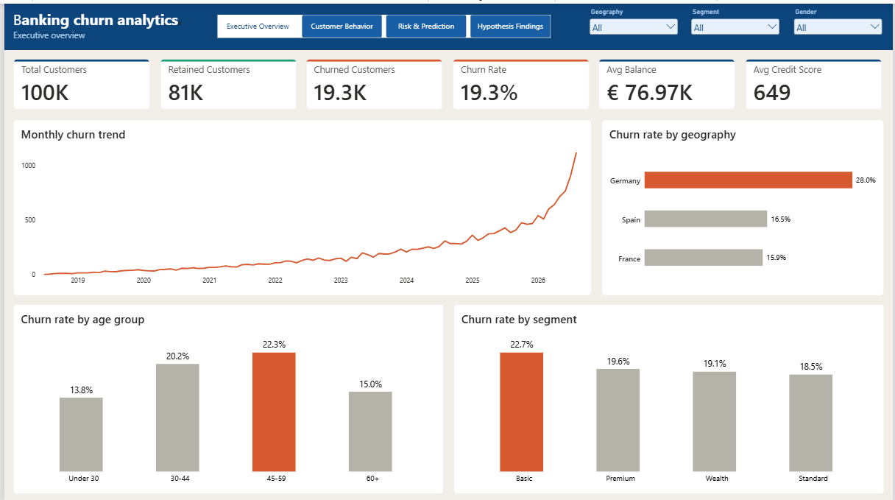
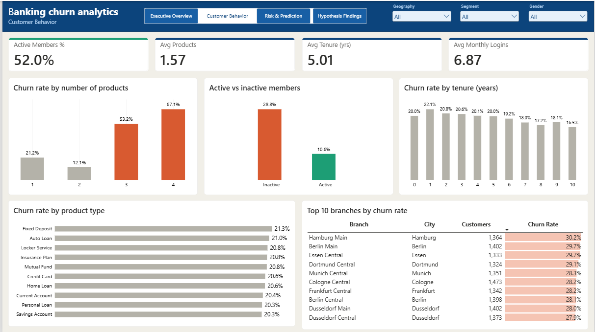
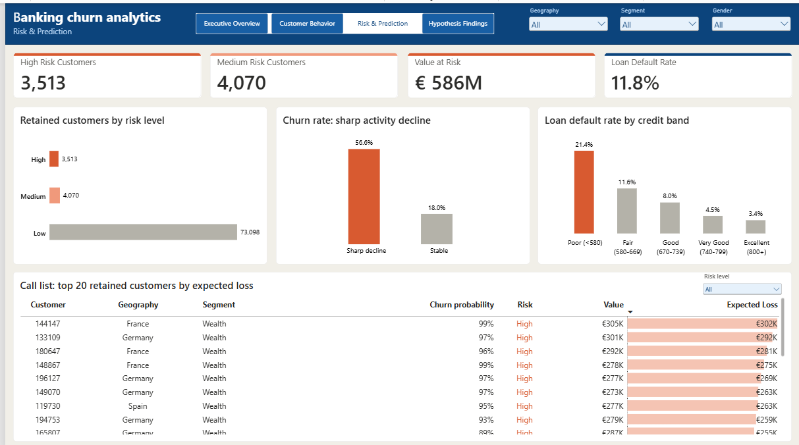
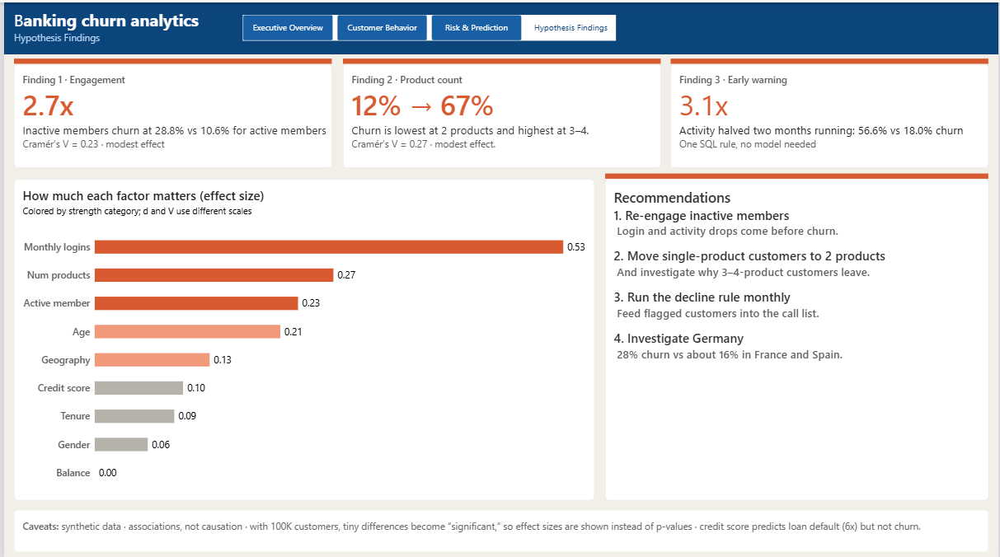

# Banking Customer Retention & Churn Prediction Analytics

**Which customers are about to leave the bank, why, and who should the retention team call first?**

An end-to-end analytics project on a 100,000-customer banking dataset: data profiling and cleaning in Python, a MySQL database with 13 business-question queries, hypothesis testing with effect sizes, a churn prediction model, a 4-page Power BI dashboard that ends in an actionable call list, and an automated pipeline that loads new weekly customer files.



---

## Key findings

| Finding | Evidence |
| --- | --- |
| **1 in 5 customers churn**, and Germany is the outlier | Overall churn 19.32%. Germany 27.96% vs France 15.89% and Spain 16.48% |
| **Engagement is the strongest driver** | Inactive members churn at 28.8% vs 10.6% for active members (2.7x) |
| **More products is not always better** | Churn is lowest at 2 products (12.1%) and jumps to 53.2% at 3 and 67.1% at 4 |
| **A simple SQL rule is an early-warning signal** | Customers whose transactions halved two months in a row churn at 56.6% vs 18.0% (3.1x) |
| **Balance, gender and tenure barely matter** | Effect sizes are negligible (d ≤ 0.10, V = 0.06) despite p < 0.001 |
| **Credit score predicts default, not churn** | Loan default is 21.4% for Poor credit vs 3.4% for Excellent (6x), but credit score has a negligible effect on churn (d = 0.10) |
| **Risk is concentrated** | The top 500 customers (0.6% of retained customers) carry €83.5M of the €586M total value at risk (14%) |

### Recommendations

1. **Re-engage inactive members.** Login and activity drops come before churn.
2. **Move single-product customers to 2 products**, and investigate why 3–4-product customers leave.
3. **Run the activity-decline rule monthly** and feed flagged customers into the call list.
4. **Investigate Germany**, where churn is 12 points higher than elsewhere.

---

## Project pipeline

```
Raw CSVs (6 tables)
   → Profiling          src/01_load_raw.py
   → Cleaning           src/02_clean.py
   → MySQL load         src/03_load_mysql.py, sql/00_schema.sql
   → SQL analysis       sql/01_business_questions.sql
   → Hypothesis tests   src/05_hypothesis_tests.py
   → Modeling           src/06_model.py
   → Scoring            src/07_score_customers.py  → churn_scores table + call list
   → Power BI views     sql/02_powerbi_views.sql
   → Dashboard          powerbi/

Weekly automation (new customer files)
   → Reference values   src/08_save_reference_values.py   (run once)
   → Pipeline           src/09_run_pipeline.py  →  validate → clean (src/cleaning.py) → upsert → rescore
```

**Tools:** Python (pandas, scikit-learn, SciPy), MySQL, SQLAlchemy, Power BI (DAX), Git

---

## Dataset

Synthetic data generated by `src/generate_bank_data.py`, deliberately messy so the cleaning stage has real work to do. See [`DATA_DICTIONARY.md`](DATA_DICTIONARY.md) for every column.

| Table | Rows |
| --- | ---: |
| customers | 100,000 (100,650 raw) |
| monthly_activity | 1,200,000 |
| customer_products | 157,299 |
| loans | 29,466 |
| branches | 60 |
| products | 10 |

---

## 1. Data profiling and cleaning

Full report: [`note/profiling_report.md`](note/profiling_report.md)

Seven issues were found and fixed in `src/02_clean.py`:

1. **650 duplicate customer IDs.** 649 were exact copies. Customer 117688 had two records with ages 51 and 250, so invalid ages were nulled **before** deduplication, otherwise the conflict would have been hidden.
2. **90 invalid ages** (below 18 or above 100), set to null and filled with the median after dedup.
3. **Geography had 12 values instead of 3** because of stray spaces and capitalization. A `GROUP BY` would have silently split each country's churn rate.
4. **Gender had 8 values instead of 2.**
5. **Balance stored as text** because of `€` symbols.
6. **Missing values** in four columns, each handled based on what the column means. For example, missing `monthly_logins` were shown to be random relative to activity status before median imputation was used.
7. **174 future-dated churn records.** These customers had churn dates after the 1 September 2026 snapshot, which is impossible. Row-level checks missed it; **the Power BI trend chart caught it** as a sudden cliff at the end of the series. All 174 were brand-new customers (tenure 0), so the bug also inflated the tenure effect from d = 0.111 to 0.094 and the churn rate from 19.32% to 19.49%.

---

## 2. SQL analysis

[`sql/01_business_questions.sql`](sql/01_business_questions.sql) answers 13 business questions using joins, CTEs, `CASE`, and window functions (`RANK`, `LAG`, running totals), including:

- Churn rate by geography, gender, age group, product count, product type, and activity status
- Top 10 branches by churn rate
- Default rate by credit score band
- Average balance by segment, ranked within each country
- Monthly churn trend and running total
- **Activity-decline early warning:** a threshold sweep comparing precision and coverage of decline rules

Every number on the dashboard matches a query in this file.

---

## 3. Hypothesis testing

Full results: [`note/hypothesis_results.md`](note/hypothesis_results.md)

Nine hypotheses were tested with t-tests and chi-square tests. With 100,000 customers, almost everything is statistically significant, so **effect sizes** (Cohen's d, Cramér's V) were used to judge practical importance.

| Variable | Effect size | Strength |
| --- | ---: | --- |
| monthly_logins | d = 0.529 | Medium |
| num_products | V = 0.265 | Modest |
| is_active_member | V = 0.230 | Modest |
| age | d = 0.213 | Small |
| geography | V = 0.134 | Small |
| credit_score | d = 0.103 | Negligible |
| tenure | d = 0.094 | Negligible |
| gender | V = 0.058 | Negligible |
| balance | d = 0.001 | None |

---

## 4. Churn prediction

Full results: [`note/modeling_results.md`](note/modeling_results.md)

| Model | ROC-AUC | Churner precision | Churner recall |
| --- | ---: | ---: | ---: |
| Logistic regression | 0.930 | 0.547 | 0.884 |
| **Random forest** | **0.970** | **0.783** | **0.876** |

- **Feature engineering mattered more than the algorithm.** Two trend features (recent vs early transaction volume) account for 72% of the random forest's feature importance and raised ROC-AUC from about 0.72 to 0.97.
- **Out-of-fold scoring.** Every customer is scored by a model that never saw them in training. Earlier in-sample scores were overconfident and *hid* risk: the top 500 customers' expected loss rose from about €63M to €83.5M after the switch.
- **Ranked by expected loss** (probability × customer value), not probability alone, so the most valuable at-risk customers are called first.

---

## 5. Power BI dashboard

The `powerbi/` folder contains the `.pbix` file and a custom theme (`churn_theme.json`). The dashboard connects to two MySQL views (`vw_customers`, `vw_loans`) that hold the business logic, such as age groups and score bands, so it stays consistent with the SQL analysis.

| Page | Question it answers |
| --- | --- |
| **Executive Overview** | What's happening? Churn KPIs, monthly trend, churn by geography, age group and segment |
| **Customer Behavior** | Who leaves? Products, activity, tenure, product type, top 10 branches |
| **Risk & Prediction** | Who's leaving next? Risk levels, activity-decline flag, default by credit band, and the call list |
| **Hypothesis Findings** | Why, and what to do? Key findings, effect sizes, recommendations and caveats |

Design choices: one font family, a four-colour system where coral always means churn or risk and only the finding gets highlighted, synced slicers across pages, and configured cross-filtering so the call-list slicer filters only the call list.





---

## 6. Automation pipeline

`src/09_run_pipeline.py` processes the weekly customer files in `data/raw/weekly_drops/`. For each file that hasn't been processed yet:

1. **Validate.** The file must have every expected column. Rows with an unknown branch, an unreadable join date, or an invalid `exited` value are not loaded; they are written to `logs/rejected/` with the reason.
2. **Clean.** `src/cleaning.py` holds the rules from `02_clean.py` as one reusable function. Missing values are filled with **fixed reference medians** (`config/reference_values.json`, saved once by `08_save_reference_values.py`), so every week follows the same rule instead of using its own batch medians.
3. **Upsert into MySQL.** New customers are inserted and existing ones updated (`INSERT ... ON DUPLICATE KEY UPDATE`) through a staging table. A customer who reappears in a later week only replaces the stored record if the new record is at least as complete, the same "keep the cleanest row" rule used in cleaning.
4. **Record and rescore.** Each loaded file is recorded in a `pipeline_runs` table in the same transaction as its data, so a file is never half-loaded and never loaded twice. If anything changed, every customer is rescored with `07_score_customers.py`.

Everything is logged to `logs/pipeline.log`.

**How it was verified:** the 8 weekly files together contain the same 100,650 raw rows as `customers_raw.csv`, with 571 of the 650 duplicate customers split across different weeks. `--test` mode loads them into an empty copy of the customers table and compares the result with `02_clean.py`'s output:

| Check | Result |
| --- | --- |
| Customers after 8 weekly loads | 100,000 |
| Churn rate | 19.32% |
| Match with `customers_clean.csv` | Identical, row for row |
| Second run on the same files | 0 files processed, no changes |
| Customer 117688 (age-250 duplicate in week 1) | Blocked; the cleaner stored record was kept |

---

## Limitations

- **Synthetic data.** The generator built a strong link between activity decline and churn, so the 0.97 ROC-AUC reflects that design. Real data would be noisier. The methodology transfers; the score does not.
- **Feature timing.** Trend features use the full 12-month window, including months after some customers had churned. In production, features must come from an observation window that ends before the prediction window.
- **Associations, not causation.** The hypothesis tests show which factors move with churn, not which ones cause it.
- **Customer value is an assumption** (balance + 10% of salary), not a real lifetime-value figure.
- **Loan default rate is a floor.** 20,322 loans are still active and may default later.

---

## How to run

**Requirements:** Python 3.10+, MySQL 8+, Power BI Desktop

```bash
# 1. Set up the environment
python -m venv venv
venv\Scripts\activate            # Windows  (source venv/bin/activate on Mac/Linux)
pip install -r requirements.txt

# 2. Create a .env file in the project root
#    DB_HOST=localhost
#    DB_PORT=3306
#    DB_USER=root
#    DB_PASSWORD=your_password
#    DB_NAME=bank_analytics

# 3. Generate the data (writes to data/raw/)
python src/generate_bank_data.py

# 4. Run the pipeline
python src/01_load_raw.py         # profile the raw data
python src/02_clean.py            # clean → data/processed/customers_clean.csv
# run sql/00_schema.sql in MySQL Workbench to create the tables
python src/03_load_mysql.py       # load all tables
python src/05_hypothesis_tests.py
python src/06_model.py            # train and evaluate models
python src/07_score_customers.py  # score all customers → churn_scores table + call list
# run sql/02_powerbi_views.sql in MySQL Workbench

# 5. Open powerbi/Banking churn analytics.pbix and refresh

# 6. Weekly automation
python src/08_save_reference_values.py   # once: saves the fixed medians
python src/09_run_pipeline.py --test     # dry run into a test table, must print TEST PASSED
python src/09_run_pipeline.py            # real run: loads new weekly files and rescores
```

---

## Repository structure

```
├── config/            database connection (reads .env) and reference_values.json
├── data/              raw, weekly and processed CSVs (gitignored; regenerate with the generator)
├── logs/              pipeline log and rejected rows (gitignored)
├── note/              profiling, hypothesis and modeling write-ups
├── outputs/           high_risk_customers.csv (the call list)
├── powerbi/           dashboard (.pbix) and theme
├── screenshots/       dashboard images
├── sql/               schema, business questions, Power BI views
├── src/               pipeline scripts
├── DATA_DICTIONARY.md
└── requirements.txt
```

---

## Next steps

- **Scheduling:** run `09_run_pipeline.py` weekly with Windows Task Scheduler, and publish the dashboard to the Power BI Service so it refreshes automatically.
- Calculate monthly churn **rate** (not just counts) so the trend chart isn't affected by the growing customer base.
- Compare each branch to its own country's average to find genuinely underperforming branches.
